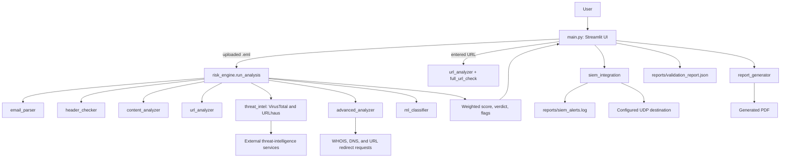

# PhishGuard — Phishing Detection and Analysis System

PhishGuard is a Python application for triaging suspicious email messages and URLs. It combines local rules, email-header and content inspection, threat-intelligence lookups, a scikit-learn classifier, and additional domain/redirect/attachment checks. A Streamlit dashboard presents the results, can save an alert locally, and can generate a PDF report.

> **Scope and safety:** This is a project/demo tool, not an email gateway or a production incident-response platform. Some analysis performs outbound requests and follows a submitted email URL's redirects. Do not use it with confidential messages, private URLs, or untrusted samples outside an isolated environment with controlled egress.

## Project overview

PhishGuard aims to combine indicators from suspicious emails and URLs into one explainable report, helping a user review a sample more quickly.

### Problem statement

Phishing triage requires analysts to inspect several indicators across an email and its links. Those indicators can include sender/authentication details, message content, URLs, and attachment metadata.

### Project objectives

- Parse `.eml` messages and extract headers, body text, URLs, authentication results, and attachment metadata.
- Apply heuristic checks to message content, sender/authentication data, and URLs.
- Enrich URLs with external reputation sources and inspect selected domain/redirect/attachment properties.
- Produce a weighted risk score, a verdict, flags, an alert record, and an optional PDF report.
- Train and use a Random Forest model from the project's feature dataset.

The score and verdict are decision-support outputs. They are not proof that a message or URL is safe or malicious.

## Key features

- **Email analysis:** `.eml` parsing with `eml-parser`; extraction of sender, reply-to, subject, date, recipients, URLs, attachment metadata, and textual SPF/DKIM/DMARC results.
- **Header and content rules:** checks for missing/failing authentication results, sender/reply-to mismatch, urgency language, credential requests, impersonation terms, HTML form patterns, suspicious attachment extensions, and URL display mismatch.
- **URL rules:** URL length, IP-literal host, suspicious terms, subdomain count, special characters, HTTP usage, and selected lookalike strings.
- **Email URL enrichment:** VirusTotal and URLhaus lookups, plus advanced checks for WHOIS/domain age (optional dependency), redirect chain, Unicode homographs, attachment extensions, DNS resolution, and reverse DNS.
- **Standalone URL checker:** local URL rules plus VirusTotal, URLhaus, PhishTank, and Google Safe Browsing. Its displayed combined score averages the four intelligence-source scores; the separate local rule score is not included in that average.
- **Machine learning:** a `RandomForestClassifier` trained on ten extracted features. If `data/model.pkl` is absent, prediction attempts to train from `data/dataset.csv`.
- **Dashboard and reports:** four Streamlit tabs (Email Analysis, URL Checker, Alerts History, Validation); optional PDF generation with ReportLab.
- **Alert output:** JSON Lines written to `reports/siem_alerts.log` and a best-effort UDP datagram sent to the configured host/port. This is not a verified integration with a specific SIEM product.

## System architecture



The email pipeline uses weights of 22% header/authentication, 18% content, 18% URL rules, 14% VirusTotal, 8% URLhaus, 10% ML, and 10% advanced analysis. Verdict thresholds are CRITICAL (75+), HIGH (50–74), MEDIUM (25–49), and LOW (0–24). The configuration dictionary in `config.py` still contains an older set of weights; `risk_engine.py` currently contains the weights used for its final score.

See [the architecture document](docs/PROJECT_ARCHITECTURE.md) for component responsibilities and data flow.

## How the system works

For an email, the application parses the EML file, runs local header/content/URL rules, requests external URL reputation, performs advanced domain/redirect checks, predicts with the ML model, and combines the layer scores. The UI then displays the result and saves a local alert; PDF creation is optional.

For a standalone URL, the app runs local URL rules and queries VirusTotal, URLhaus, PhishTank, and Google Safe Browsing. The four-source average is displayed separately from the local rule score. Both workflows can produce incomplete results when a network source is unavailable.

## Project structure

```text
.
├── main.py                       # Streamlit interface and UI orchestration
├── config.py                     # dotenv settings, paths, thresholds, legacy weights
├── requirements.txt              # Pinned Python packages
├── .streamlit/config.toml        # Streamlit theme/server settings
├── .vscode/settings.json         # VS Code terminal setting
├── modules/
│   ├── email_parser.py
│   ├── header_checker.py
│   ├── content_analyzer.py
│   ├── url_analyzer.py
│   ├── threat_intel.py
│   ├── advanced_analyzer.py
│   ├── ml_classifier.py
│   ├── risk_engine.py
│   ├── siem_integration.py
│   └── report_generator.py
├── data/
│   ├── dataset.csv               # Tracked training feature/label data
│   ├── phishing_full.csv         # Tracked source dataset used by expansion script
│   ├── test.eml                  # Tracked example message
│   ├── create_dataset.py
│   ├── download_dataset.py
│   ├── expand_dataset.py
│   └── validation.py
├── reports/
│   └── validation_report.json    # Tracked metrics snapshot read by the dashboard
├── SAFE_LAB.md                   # Safety notes; see caveats below
└── docs/                         # Arabic explanation, installation, and presentation
```

Local-only files also exist in a developer checkout: `.env`, `data/model.pkl`, `data/phishing_raw.csv`, `reports/siem_alerts.log`, and a generated incident PDF. They are excluded by `.gitignore`; keep them local unless there is a reviewed, explicit reason to share them. `venv/`, `.venv/`, and Python bytecode caches are local environment artifacts. The two tracked `.agents`/`.claude` skill symlinks currently point into the local virtual environment and may not resolve in another checkout.

### Dataset provenance

The download scripts reference [GregaVrbancic/Phishing-Dataset](https://github.com/GregaVrbancic/Phishing-Dataset) and [Rohith-2/URL-Feature-Extraction](https://github.com/Rohith-2/URL-Feature-Extraction). This confirms the URLs encoded in the scripts, not the full provenance or redistribution license of every checked-in dataset file. Verify upstream terms and data lineage before redistributing the CSV files.

## Technologies and tools used

| Technology | Use in this project |
|---|---|
| Python | Application, parsers, analysis, and scripts |
| Streamlit | Four-tab web interface |
| Plotly | Score charts |
| pandas / NumPy | Dataset loading, feature processing, and validation |
| scikit-learn | Random Forest training, prediction, and metric calculations |
| `eml-parser` | EML decoding and metadata extraction |
| Beautiful Soup | HTML-form and image inspection in message content |
| Requests | Threat-intelligence API calls and redirect checks |
| `python-dotenv` | Loading local `.env` configuration |
| ReportLab | PDF incident report creation |
| `python-whois` | Optional WHOIS lookup; absence is handled by the analyzer |
| JSON / JSON Lines | Validation snapshot and local alert records |

The requirements file pins a broad set of packages, including transitive and currently unused packages. The table above describes packages used directly by the reviewed code rather than every package listed in that file.

### Official documentation

- [Python](https://docs.python.org/3/)
- [Streamlit](https://docs.streamlit.io/)
- [Plotly Python](https://plotly.com/python/)
- [pandas](https://pandas.pydata.org/docs/) and [NumPy](https://numpy.org/doc/)
- [scikit-learn](https://scikit-learn.org/stable/)
- [Beautiful Soup](https://beautiful-soup-4.readthedocs.io/en/latest/) and [`eml-parser` package page](https://pypi.org/project/eml-parser/)
- [Requests](https://requests.readthedocs.io/en/latest/) and [ReportLab](https://www.reportlab.com/docs/reportlab-userguide.pdf)
- [python-dotenv package page](https://pypi.org/project/python-dotenv/) and [python-whois package page](https://pypi.org/project/python-whois/)
- [VirusTotal API](https://docs.virustotal.com/reference/overview), [URLhaus API](https://urlhaus.abuse.ch/api/), [PhishTank API](https://phishtank.org/api_info.php), and [Google Safe Browsing API](https://developers.google.com/safe-browsing/v4)

## Prerequisites

- Windows, macOS, or Linux with Python 3.11 recommended. The available project environment was Python 3.11.3; no other Python version was verified in this review.
- `pip` and Git.
- Outbound network access only if using external threat-intelligence lookups or redirect analysis.
- A VirusTotal API key for meaningful VirusTotal results. A Google Safe Browsing API key is optional for that URL-checker source. URLhaus and PhishTank are called without a key by the current code.
- A UDP syslog receiver is optional. Without one, the application still writes local alerts; the default destination is `localhost:514`.

## Installation guide

From PowerShell:

```powershell
git clone https://github.com/macman1990/phishing-detection.git
Set-Location phishing-detection
py -3.11 -m venv venv
.\venv\Scripts\python.exe -m pip install --upgrade pip
.\venv\Scripts\python.exe -m pip install -r requirements.txt
```

The GitHub URL above follows the repository identity available in this workspace; use the appropriate URL if working from a fork or private mirror. Dependency installation was not repeated while preparing these documents.

## Configuration and environment setup

Create a local `.env` file in the repository root. Do not commit it or put real secrets in examples:

```dotenv
VIRUSTOTAL_API_KEY=replace_with_your_own_key
GOOGLE_API_KEY=replace_with_your_own_key
SIEM_HOST=localhost
SIEM_PORT=514
```

`VIRUSTOTAL_API_KEY` is read by the email and URL checks. `GOOGLE_API_KEY` is optional; without it, Google Safe Browsing returns an `Unknown` result. `SIEM_HOST` and `SIEM_PORT` configure best-effort UDP output. `config.py` also contains relative paths for the model, dataset, reports, and log.

WHOIS is optional and not pinned in `requirements.txt`; install `python-whois` separately only if domain-age lookups are needed. A fresh install without it continues with that check unavailable.

## How to run the project

```powershell
.\venv\Scripts\streamlit.exe run main.py
```

Open the local URL shown by Streamlit (normally `http://localhost:8501`). The project also has a local Streamlit configuration at `.streamlit/config.toml`.

## How to use the system

1. Open **Email Analysis** and upload an `.eml` file.
2. Review the verdict, layer scores, extracted metadata, flags, and advanced results.
3. The app writes an alert to the local JSONL history and attempts a UDP send.
4. Use **Download Incident Report** to generate a PDF, then save it through the download button.
5. In **URL Checker**, enter a URL to run local rules and four external intelligence lookups.
6. **Alerts History** reads the local alert log. **Validation** displays the saved JSON metrics snapshot.

**Network/privacy warning:** email analysis can send extracted URLs to VirusTotal and URLhaus and makes direct HTTP requests when following redirects. The standalone URL checker sends the entered URL to the configured intelligence services. URLs may contain private identifiers or query tokens. Do not upload confidential mail or internal URLs unless disclosure to those services is explicitly approved. The application does not enforce network isolation or restrict redirect destinations.

## Example usage

The following example evaluates a URL with local string rules only; it does not make a network request:

```powershell
.\venv\Scripts\python.exe -c "from modules.url_analyzer import analyze_url; print(analyze_url('https://example.com'))"
```

The EML command-line entry point exists, but it performs the same network-capable checks as email analysis. Use only an authorized sample in an isolated environment:

```powershell
.\venv\Scripts\python.exe -m modules.risk_engine path\to\authorized-sample.eml
```

The model can be trained locally from the tracked feature dataset without running email or URL checks:

```powershell
.\venv\Scripts\python.exe -c "from modules.ml_classifier import train_model; train_model()"
```

`data/validation.py` requires `data/model.pkl` and writes/overwrites the tracked `reports/validation_report.json`. Back up that report before rerunning validation if you need to retain the current snapshot. Dataset scripts can contact remote hosts and overwrite `data/dataset.csv`; `data/create_dataset.py` writes a small example dataset to the same path. Do not run these scripts casually against the current data.

## Output and reports

- The PDF generator writes `reports/incident_report.pdf` by default.
- Alerts are appended as JSON Lines to `reports/siem_alerts.log`. The dashboard skips malformed lines when reading the log.
- The dashboard reads `reports/validation_report.json`.

The tracked validation snapshot currently records:

| Metric | Stored value |
|---|---:|
| Dataset rows | 99,004 |
| Accuracy | 0.880 |
| Precision | 0.871 |
| Recall | 0.801 |
| F1 | 0.834 |
| ROC AUC | 0.941 |
| False-positive rate | 0.073 |
| Average prediction latency | 3.988 ms |
| Confusion matrix (TP / TN / FP / FN) | 9,078 / 17,023 / 1,342 / 2,259 |

These are values in the existing JSON file, not a fresh benchmark from this documentation task. `data/validation.py` uses five-fold cross-validation for its accuracy field and a separate 70/30 split for the other classification metrics; no timestamp or dataset provenance is recorded in the JSON. Treat the values as a historical project snapshot, not a performance guarantee.

The MITRE ATT&CK cards and PDF mapping are static labels in the UI/report code; they are not a separate ATT&CK detection engine or a validated coverage assessment.

## Testing and verification

There is no dedicated unit-test directory or configured pytest suite in the repository. `data/validation.py` is a model-evaluation script, not a unit-test suite, and it mutates `reports/validation_report.json`. During this review, all project Python files were parsed with Python's AST parser and the existing validation JSON was read; the model validation and network-capable application paths were not executed.

No screenshots are committed. Add only genuine screenshots captured from the running application, after removing personal data, API responses, and secrets; do not use fabricated result images.

## Troubleshooting

- **Missing `.env` or API errors:** set your own VirusTotal key; API errors currently produce an unknown/zero score in some result fields, which must not be interpreted as proof of safety.
- **Google Safe Browsing says `Unknown`:** configure `GOOGLE_API_KEY`; without a key, the current code intentionally returns `Unknown`.
- **WHOIS fields are unavailable:** install `python-whois` if desired and allow the corresponding lookup.
- **Model file is missing:** the first prediction attempts to train from `data/dataset.csv`; alternatively run the explicit local training command above.
- **Validation script reports a missing model:** train the model first. The validation script does not create the model itself.
- **No alerts appear:** check whether `reports/siem_alerts.log` exists and is readable; the log is ignored by Git and remains local.
- **UDP SIEM send is false:** verify the host/port and that a receiver is listening. A successful UDP `sendto` does not confirm that a SIEM ingested the alert.
- **A clean URL result seems inconclusive:** individual API failures can be assigned zero scores by the current aggregation; check each source's status and do not equate `Unknown` with `Clean`.

## Security and privacy considerations

- There is no enforced sandbox, authentication, authorization, rate limiting, or egress policy in the app.
- `advanced_analyzer.py` follows redirects for a supplied email URL with TLS verification disabled. A deployed service could make requests to destinations reachable from its host. Do not expose this interface to arbitrary users or test internal network addresses.
- URLs and email indicators are sent to third-party services. Local alerts can include sender, subject, URLs, and flags.
- Some untrusted email fields and alert values are rendered in custom HTML; escaping is inconsistent. The app is not hardened for public multi-user deployment.
- Pickle models must come from a trusted source; loading an untrusted pickle can execute code.

## Known limitations

- Several external errors are normalized to zero/unknown scores, but the final combined URL verdict can still appear `Clean`. Review source-level errors before making decisions.
- Email analysis uses VirusTotal and URLhaus; PhishTank and Google Safe Browsing are used by the standalone URL checker, not by `risk_engine.run_analysis`.
- The ML model uses hand-engineered URL/authentication features and a dataset whose provenance/quality should be checked before relying on the reported metrics.
- The upstream dataset references are in download scripts, but redistribution terms and the exact lineage of tracked CSV files are not documented.
- `config.WEIGHTS` is stale relative to the weights in `risk_engine.py`; the latter currently determines email scores. Some static landing-page counts/metrics in `main.py` are also stale.
- The alert builder does not receive a `ml_result` field from `risk_engine.py`, so the recorded alert's ML verdict/score can fall back to `Unknown`/zero even though `ml_score` is present in the score breakdown.
- No license file is present. The original README describes an educational project but does not grant a reuse license; add a license only after the owner chooses one.

## Future improvements

Potential next steps, subject to project-owner review, include making external lookups optional/explicit, restricting redirects and validating URLs, consistent escaping of untrusted fields, distinguishing unavailable intelligence from a clean finding, reconciling the weights/configuration and displayed metrics, adding automated tests, recording dataset/model provenance, and documenting a concrete SIEM receiver format.

## Contributors

The original README names **YUSIF ALI** and describes the project as an AMIT graduate project/SOC Blue Team track. No additional contributor information was verified.

## License

No `LICENSE` file is present. The project is not assigned an open-source license in this repository.

## Further documentation

- [Arabic project explanation](docs/PROJECT_EXPLANATION_AR.md)
- [Arabic installation guide](docs/INSTALLATION_GUIDE_AR.md)
- [Arabic presentation draft](docs/PRESENTATION_AR.md)
- [Arabic expected questions](docs/EXPECTED_QUESTIONS_AR.md)
- [System architecture](docs/PROJECT_ARCHITECTURE.md)
- [Cleanup review](cleanup_review/CLEANUP_REVIEW_AR.md)
