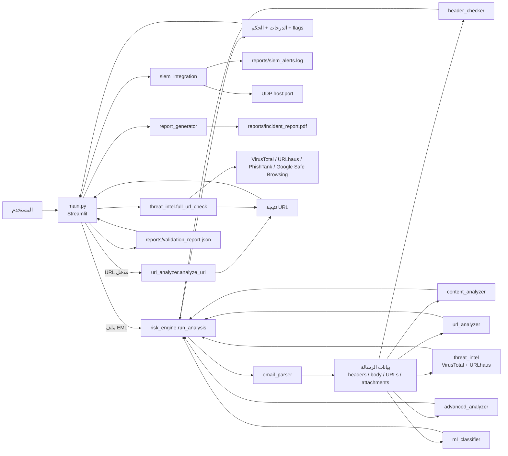

# معمارية نظام PhishGuard

## نظرة عامة

المشروع تطبيق Python بواجهة Streamlit، وليس خدمة Backend منفصلة أو قاعدة بيانات. نقطة الدخول التفاعلية هي `main.py`. تنسّق الواجهة بين مساري تحليل البريد وفحص الرابط، بينما توجد قواعد التحليل والتكاملات الخارجية وإنشاء التنبيه والتقرير في `modules/`.

## مخطط المكونات وتدفق البيانات

## نقاط الدخول

| نقطة الدخول | الوظيفة |
|---|---|
| `streamlit run main.py` | تشغيل لوحة Streamlit ذات أربع تبويبات: Email Analysis، URL Checker، Alerts History، Validation. |
| `python -m modules.risk_engine <email.eml>` | تحليل EML وطباعة كائن التقرير بصيغة JSON. المسار ينفذ اتصالات خارجية عند وجود URLs. |
| `python -m modules.report_generator <email.eml>` | تحليل EML ثم إنشاء PDF؛ لذلك يرث اتصالات مسار التحليل. |
| `python -m modules.ml_classifier` | تدريب النموذج ثم تحليل عينة؛ هذا المسار لا يقتصر على التدريب ويستدعي تحليل البريد. |
| `python data/validation.py` | تقييم النموذج وكتابة/استبدال `reports/validation_report.json`. يتطلب ملف النموذج. |
| `python data/download_dataset.py` | تنزيل مصدر البيانات وإعادة تكوين `data/dataset.csv`؛ اتصال خارجي وكتابة للبيانات. |
| `python data/expand_dataset.py` | تنزيل ملفات بيانات ومحاولة دمجها ثم استبدال `data/dataset.csv`. اتصال خارجي وكتابة للبيانات. |
| `python data/create_dataset.py` | إنشاء مجموعة صغيرة من الأمثلة وكتابة فوق `data/dataset.csv`. |

## مسؤولية المكونات

### الواجهة والتكوين

- **`main.py`:** يعرّف تصميم الواجهة والتبويبات وعرض الدرجات والنتائج. عند رفع بريد، يكتب الملف إلى ملف مؤقت، يستدعي المحرك، يحفظ التنبيه، ثم يعرض النتيجة وخيار إنشاء PDF.
- **`config.py`:** يحمّل `.env` عبر `python-dotenv` ويحدد مفاتيح API ووجهة UDP ومسارات النموذج والبيانات والتقارير. قاموس الأوزان فيه قديم ولا يطابق الأوزان المستخدمة فعليًا في `risk_engine.py`.
- **`.streamlit/config.toml`:** إعدادات المظهر والمنفذ، والمنفذ الافتراضي المضبوط هنا 8501.

### مسار البريد

1. `email_parser.parse_email` يقرأ EML بالبايتات ويستخرج حقول الرسالة والروابط وبيانات المرفقات ونتائج المصادقة الموجودة نصيًا في الترويسات.
2. `header_checker.check_headers` يحسب إشارات SPF/DKIM/DMARC وReply-To والإلحاح وانتحال النطاق.
3. `content_analyzer.analyze_content` يطبق أنماطًا نصية وقواعد HTML ومؤشرات المرفقات والروابط.
4. `url_analyzer.analyze_urls_from_email` يطبق قواعد محلية على الروابط.
5. `threat_intel.check_urls_list` و`check_urlhaus_list` يطلبان نتائج VirusTotal وURLhaus لكل رابط.
6. `advanced_analyzer.run_advanced_analysis` يطلب WHOIS اختياريًا، ويفحص Unicode وامتدادات المرفقات وDNS/reverse DNS، ويتبع redirects لأول رابط باستخدام HTTP.
7. `ml_classifier.predict` يحول أول رابط وبعض مؤشرات المصادقة إلى عشرة خصائص ويستخدم Random Forest.
8. `risk_engine.run_analysis` يدمج النتائج. الأوزان هي 22% headers، و18% content، و18% URL rules، و14% VirusTotal، و8% URLhaus، و10% ML، و10% advanced. ثم يطبق حدود الحكم 75/50/25.
9. الواجهة تحفظ تنبيهًا محليًا وتحاول إرساله عبر UDP، وتعرض النتيجة. إنشاء PDF لا يحدث إلا عند الضغط على زر التقرير.

فحوص SPF/DKIM/DMARC هنا تعتمد على النتائج المستخرجة من `Authentication-Results` داخل الرسالة؛ لا يظهر في الكود استعلام مستقل للتحقق الحي من سجلات البريد.

### مسار فحص الرابط المستقل

1. `url_analyzer.analyze_url` ينتج درجة محلية وقواعد/flags.
2. `threat_intel.full_url_check` يستدعي VirusTotal وURLhaus وPhishTank وGoogle Safe Browsing.
3. الدرجة المعروضة كـ Combined هي متوسط درجات المصادر الأربعة؛ درجة Rule Engine تعرض منفصلة ولا تدخل في المتوسط.

أخطاء بعض المصادر تعود كـ `Unknown` ودرجة صفر؛ التجميع الحالي قد ينتج حكمًا يبدو `Clean` رغم تعذر بعض الاستعلامات.

## مصادر البيانات والتخزين

- `data/dataset.csv`: ملف الميزات والتصنيف الذي يقرأه التدريب والتحقق.
- `data/phishing_full.csv`: ملف مصدر متعقب تستخدمه أداة توسيع البيانات.
- `data/phishing_raw.csv`: ملف محلي مستثنى من Git، تكتبه أداة التنزيل وتقرأه أداة التحضير.
- `data/model.pkl`: نموذج pickle محلي مستثنى من Git. إذا غاب، يحاول `load_model` التدريب من `data/dataset.csv`.
- `reports/validation_report.json`: لقطة مقاييس متعقبة يقرأها تبويب Validation. أداة التحقق تعيد كتابته.
- `reports/siem_alerts.log`: سجل JSON Lines محلي يستعمله تبويب Alerts History؛ الملف مستثنى من Git.
- `reports/incident_report.pdf`: ملف PDF مولّد محليًا ومستثنى من Git.

لم يُعثر في مسار التنفيذ على قاعدة SQLite؛ التخزين الظاهر هو ملفات CSV وJSON وJSONL وpickle وPDF.

## الاعتماديات الخارجية والشبكية

- APIs: VirusTotal، URLhaus، PhishTank، Google Safe Browsing.
- الشبكة المحلية/العامة: طلب redirect مباشر، WHOIS اختياري، DNS وreverse DNS، وUDP للـ SIEM.
- لا توجد قائمة سماح للوجهات أو حماية SSRF في مسار redirect الحالي. كما أن طلب redirect يستخدم `verify=False`.
- التطبيق لا يفرض عزل الشبكة أو المصادقة أو التفويض. يلزم إعداد هذه الضوابط خارج التطبيق قبل أي نشر.

## التحقق والحدود

- لا توجد مجموعة اختبارات وحدات ظاهرة. `data/validation.py` يقيس النموذج ولا يمثل اختبارات تكامل للتطبيق.
- لقطة `reports/validation_report.json` تعرض `dataset_size=99004` و`accuracy=0.88` و`precision=0.871` و`recall=0.801` و`f1_score=0.834` و`auc_roc=0.941` و`false_positive_rate=0.073` و`avg_latency_ms=3.988`. لم تُعد هذه التجربة أثناء إعداد الوثائق؛ الملف لا يسجل تاريخ التقييم أو مصدر البيانات.
- `whois` اختياري في الشيفرة لكنه غير مثبت في `requirements.txt`.
- لم يتم اختبار الاتصال بمزودات خارجية أو استقبال UDP أثناء المراجعة.
- `.agents` و`.claude` روابط رمزية متعقبة تشير إلى ملف مهارة داخل `venv` المحلي؛ قد تكون مكسورة في checkout آخر.
